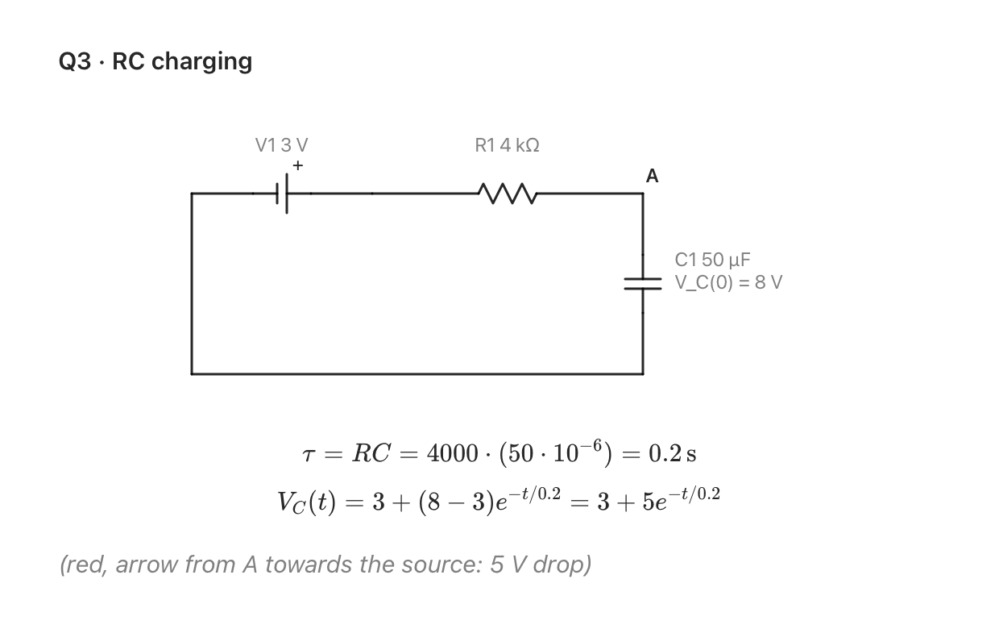
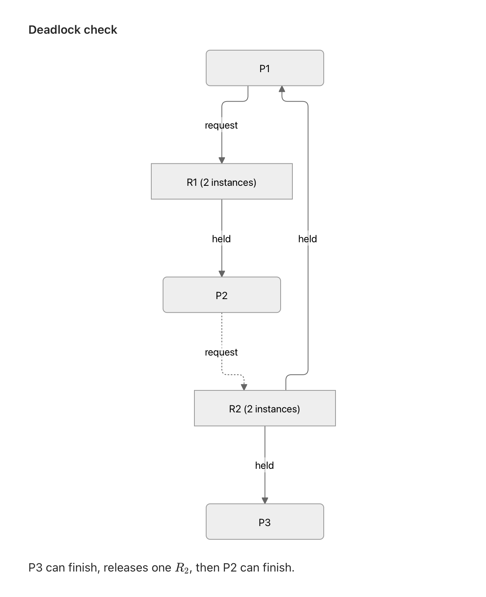

<p align="center">
  
</p>

<h1 align="center">Auxilius</h1>

<p align="center">
  <b>Work on paper. Your AI chat follows along.</b><br>
  A small Mac app that reads your handwriting through the Desk View camera, as you write.
</p>

<p align="center">
  <a href="https://github.com/HNagouda/Auxilius/actions/workflows/build.yml"></a>
  
  
  
</p>

You ask a chat for help with a circuits exercise, work it out on paper, and then spend ten minutes typing time constants, exponents and a resistor network back into the chat box. And the chat still never sees your working, only the answer you typed.

Auxilius fixes that. Put your page under the Mac's Desk View camera and just write. Every time you pause, it reads the page and turns it into clean text: maths as LaTeX, circuits as real schematics, and diagrams like resource allocation graphs redrawn. Your chat can look at the page whenever you mention it, so "check my working on part b" just works.

<p align="center">
  <picture>
    <source media="(prefers-color-scheme: dark)" srcset="docs/transcript-dark.png">
    
  </picture>
</p>

## What it does

- **Follows along as you write.** It notices when your hand stops moving and there's new ink, and reads the page only then. No button to press, and no request while you're mid-stroke.
- **Maths comes out as LaTeX**, typeset in the app and ready to paste into any chat.
- **Circuits become schematics** with real symbols, traced from the layout you drew. The chat gets the same circuit as a SPICE netlist, which it reasons over far better than over a picture.
- **Other diagrams are redrawn too:** flowcharts, trees, state machines, resource allocation graphs.
- **Your original sketch stays one click away** under every diagram, so you can check the redraw against what you actually drew.
- **Chats can see your page** through a built-in MCP server (Model Context Protocol, the standard way chat apps connect to local tools). It works with Claude Desktop, Claude Code and the Codex mode of the ChatGPT desktop app. Anywhere else, Copy puts the whole transcript on your clipboard.

<p align="center">
  <picture>
    <source media="(prefers-color-scheme: dark)" srcset="docs/graph-dark.png">
    
  </picture>
</p>

## Install

1. Download `Auxilius.dmg` from the [latest release](https://github.com/HNagouda/Auxilius/releases/latest) and drag Auxilius onto Applications.
2. The app isn't signed with an Apple Developer ID yet, so macOS blocks it the first time. Clear the block once in Terminal:
   ```
   xattr -dr com.apple.quarantine /Applications/Auxilius.app
   ```
3. Open it and allow camera access. It picks a Desk View camera on its own: the MacBook's built-in one, or your iPhone's through Continuity Camera.

It needs a Mac with Apple silicon and macOS 14 or later.

## Turn on transcription

Paste an Anthropic API key in Settings (⌘,). It's stored in your login keychain, and the Model picker lists every model on your account that can read images (Claude Opus 5.5 by default).

Without a key, Auxilius still captures your page, and a connected chat reads the photo directly.

## Connect your chat

In Settings, under Chat:

| Chat | How |
|---|---|
| Claude Desktop | Press **Connect**, then quit and reopen Claude Desktop |
| ChatGPT desktop app (Codex mode) | Press **Connect**, then restart the ChatGPT app |
| Claude Code | Press **Copy Command** and run it in a terminal |
| Anything else, including ChatGPT's normal chat | Press **Copy** under the transcript (⇧⌘C) and paste |

Then just talk about your paper: "look at my working, where did I go wrong?" The chat calls the `read_paper` tool and gets the photo plus the transcript.

ChatGPT's normal chat mode only connects to remote servers today, which is why the local tool works in its Codex mode and Copy covers the rest.

## Privacy

The camera feed never leaves your Mac. Only a still photo of the page goes out: to the Anthropic API when you've added a key, and to your chat app when it asks for the page. The latest page is kept in `~/Library/Application Support/Auxilius/`. The page history (Settings, History) is off by default; when it's on, it keeps up to 1,000 pages on disk to build a test set.

## Where it's going

The next step is running fully on-device, with no API key and no network. Small open vision models such as Qwen3.5 (4B and 9B) and dedicated OCR models such as PaddleOCR-VL now run on Apple silicon through MLX. Nobody has published how they do on handwritten maths, though, so the plan is to benchmark them on real pages collected by the page history before choosing one.

## Build it yourself

You only need the Command Line Tools, not Xcode:

```
git clone https://github.com/HNagouda/Auxilius.git
cd Auxilius
./scripts/build.sh --install
```

`./scripts/build.sh --dmg` builds the disk image instead. How the pipeline works, where each piece lives, and how to change it are in [docs/DEVELOPMENT.md](docs/DEVELOPMENT.md).

The name is Latin: *oculus* (eye) plus *auxilium* (help).
